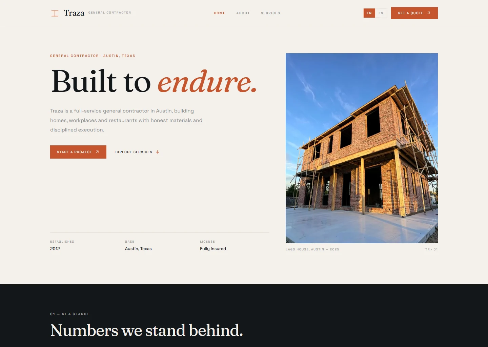

# Traza

A bilingual site for a small general contractor in Austin, Texas, built as an original implementation with no page templates or copied assets.



## What it is

Traza is a complete front-end marketing site for a general contractor: a home page, an about page and a services page, in English and Spanish.

It is a demo, not a live contractor. There is no CMS, backend or form service: the quote call to action opens the email client, the copy-email control writes to the clipboard, and every company detail — address, phone, team, clients and projects — is fictional.

## Why this over a contractor template

- **Clean-room build.** Layout, copy, palette and artwork were written for this project; no page template, copied class names or stock assets.
- **Bilingual by default.** `/[locale]` routes, typed dictionaries, automatic browser-language detection, a manual switcher and `hreflang` alternates.
- **Market rules in one file.** Currency and locale live in `src/config/region.ts`; site identity lives in `src/config/site.ts`.
- **No remote media.** All eight photographs are local WebP files generated for the brand, so the page makes no third-party image requests.
- **Small dependency surface.** Next.js, React, Tailwind CSS and lucide-react. No UI kit, no animation library, no state manager.

## Quick start

Requirements: Node.js 24 (see `.nvmrc`) and pnpm 11.

```bash
git clone https://github.com/JORDANROBERTO74/traza.git
cd traza
pnpm install
pnpm dev
```

Open <http://localhost:3000>. The proxy redirects to `/en` or `/es` based on your browser's `Accept-Language` and remembers an explicit choice in a cookie.

| Command | What it does |
| --- | --- |
| `pnpm dev` | Start the development server on port 3000 |
| `pnpm build` | Create an optimized production build |
| `pnpm start` | Serve the production build |
| `pnpm lint` | Run ESLint |
| `pnpm typecheck` | Run `tsc --noEmit` |

## Internationalization

Copy lives in `src/i18n/dictionaries/en.ts` and `es.ts`. The English file defines the `Dictionary` type, so a missing or misspelled key in Spanish fails `pnpm typecheck` instead of rendering a blank label.

- `src/i18n/config.ts` lists the supported locales and the default (`en`).
- `src/proxy.ts` detects the locale and redirects `/` to `/{locale}`.
- `src/lib/seo.ts` centralizes canonical and `hreflang` alternates.
- Names, projects, services, stats and testimonials are localized data, not hard-coded markup.

## Region and currency

Market settings live in `src/config/region.ts`:

```ts
export const region = {
  id: "us",
  currency: "USD",
} as const;
```

Site identity — name, domain, email and phone — lives in `src/config/site.ts`. Quotes are in US dollars; the contact section states that permit fees and taxes are excluded.

## Pages and content

- **Home:** hero, four metrics, six services, a four-step process, four values, selected work, testimonials and a contact block with copy-email.
- **About:** story, three promises, expertise, team and values.
- **Services:** capabilities, the same four-step process and a call to action.
- **404:** a localized not-found page inside the locale layout.

## Artwork

`public/images/*.webp` are AI-generated photographs produced with `flux-2-klein-4b` through the local `image-forge` tool. The hero and project shots use a warm material palette (brick, timber, steel, concrete), carry no lettering or logos, and are self-hosted so the page makes no remote image requests.

## Project structure

```text
src/
  app/[locale]/          routes: home, about, services, not-found, Open Graph image
  components/            layout, home, about, services, shared, brand mark, copy-email
  config/                site identity and region/currency settings
  i18n/                  locale config, typed dictionaries and loader
  lib/                   SEO helpers and utilities
  assets/                static font instances for the Open Graph route
docs/
  screenshot.webp
```

## Deployment

The app uses the default Vercel Next.js preset; no `vercel.json` is required.

1. Import the repository and keep the detected settings (`pnpm install`, `pnpm build`, output `.next`).
2. Set `NEXT_PUBLIC_SITE_URL` to the production origin.
3. Deploy, then verify `/{en,es}`, `/sitemap.xml`, `/robots.txt` and both Open Graph images.

`NEXT_PUBLIC_SITE_URL` drives canonical links, `hreflang`, `sitemap.xml`, `robots.txt` and Open Graph URLs. When it is unset, the code falls back to `https://traza-woad.vercel.app`.

Live demo: <https://traza-woad.vercel.app>

## Status and scope

This is a portfolio reference implementation, maintained but not a production contractor site. There is no CMS, authentication, form backend or analytics beyond Vercel's defaults. Verification covers `pnpm lint`, `pnpm typecheck`, `pnpm build` and a manual pass in both locales at desktop and mobile widths.

## License

Proprietary, all rights reserved. See [LICENSE](LICENSE). Third-party dependencies remain under their own licenses.
